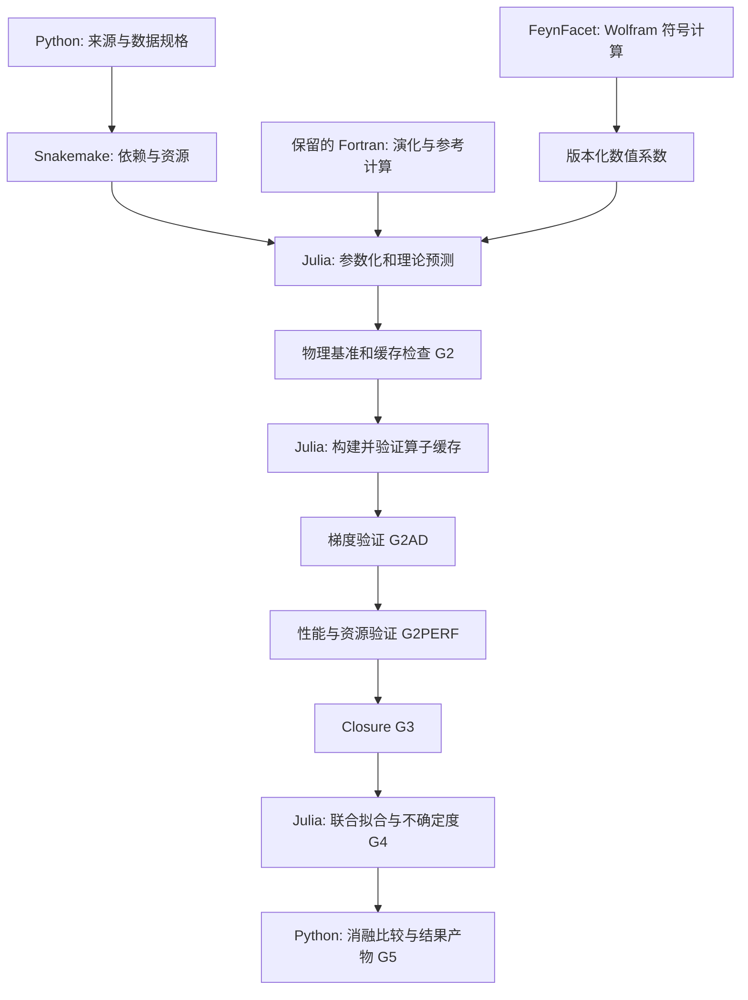

# Julia 数值内核与 Python/Snakemake 调度

实施状态补充：合成闭环数值包、CLI、Snakemake 和固定算子批量 ABI 已实现；生产理论和验收仍待完成。当前实测证据与限制见 [implementation-status.md](implementation-status.md)，下文保留 ADR-001 的科学设计要求。

ADR-001，2026-11-11，用户已确认。本文更新实施设计，不代表生产后端、Fortran 修改或验证实验已经完成。机器可读规格在 [numerical-backends.json](../config/numerical-backends.json)，阶段依赖在 [workflow.json](../config/workflow.json)。

## 语言与任务边界

Julia 负责参数化、演化算子的应用、SIDIS/SIA/jet/moment 预测、积分、似然、梯度、优化及不确定度计算。Python 负责来源与数据处理、验证报告和结果生成；Snakemake 负责依赖、资源、失败传播、重启和更新失效。一个任务启动一个执行完整 fit、replica、chain 或 validation job 的 Julia 进程，不在每个参数步或积分节点往返 Python。生产优化循环不调用 LLM。

选择 Julia 的理由是新数值实现可在同一种语言中组织循环、参数化和可微计算。此前 Python 的优势是公开代码与接口的复用成本；目前没有实测语言加速比。调用相同 Fortran 库时，主要耗时仍可能在库内。[Julia 性能指南](https://docs.julialang.org/en/v1/manual/performance-tips/)

FeynFacet 的 Wolfram/Mathematica 程序继续作为符号计算工具链，导出经过验证、带版本的 hard coefficients。已有 JAM/tParton Python 程序用于独立参考任务，不放入 Julia 的高频计算路径。JAM 默认理论与 KPSY CSS 理论不同，不能以两者逐点一致作为跨语言验收。

## Fortran 的保留、优化与重写

下面是后续实施的处置决定。固定在 `external/` 的上游快照保持不变；优化在项目桥接层或经审查的 fork 中进行，并保留原版作 A/B 参考。

| 处置 | 实际模块或函数 | 实施范围与条件 |
|---|---|---|
| 保留 | HOPPET `evolution.f90`、`runge_kutta.f90` | 保留求解器和步进器；先分析真实瓶颈 |
| 保留 | `convolution.f90`、`interpolation.f90` | 保留 grid、plus distribution、端点和插值处理；Julia 可应用其生成的算子 |
| 保留 | `qcd_coupling.f90`、`new_as.f90`、`special_functions.f90` | 保持选定阶数、耦合及阈值约定 |
| 优化 | `pdf_tabulate.F90`；`PreEvolvePdfTable`、`hoppetPreEvolve`、`hoppetCachedEvolve` | 复用初始化和预演化，按依赖缓存算子，批量处理输入与查询，减少临时分配 |
| 优化 | `streamlined_interface.f90` 的接口与状态管理 | 新增窄的 `ISO_C_BINDING`/`bind(C)` 桥；明确数组尺寸、所有权、错误和上下文；避免逐标量回调 |
| Julia 重建 | 尚未找到的 KPSY15 专用 transversity/Collins 演化修改 | 按论文、阶数和近似重建 kernel/adapter；明确标为 reconstruction，独立验证后使用 |
| 条件重写 | 经 profiling 确认的演化、卷积或插值热点 | 缓存、批量化和分配优化后仍有必要，才逐个替换；同 API 保留参考后端 |
| 新建 Julia | 参数化、过程 adapter、算子应用、似然和 inference | 使用显式 context，减少可变全局状态，支持适合所选 AD 的数值类型 |

上游的 cached evolution 接口确实存在，但没有据此声称已经具备 transversity 算子导出功能。上游 polarized 功能也不能直接认作作者的 transversity 修改。原 KPSY fitting 程序与作者修改版 HOPPET 仍未定位。

Julia 可以调用 C/Fortran；`bind(C)` 桥可减少编译器相关的隐藏参数问题。[Julia 接口文档](https://docs.julialang.org/en/v1/manual/calling-c-and-fortran-code/)

当前 streamlined interface 有 module `SAVE` 状态。初期用进程隔离各 replica/chain 的上下文，不能假设在同一库实例上并发调用安全。Snakemake 分配的 CPU 数须同时约束 Julia、BLAS 和 OpenMP，避免嵌套并行超额。编译器与 flags 进入 receipt；默认不启用 fast-math 或降低精度。

## 梯度如何跨过演化计算

固定耦合、初始尺度、阈值、演化阶数、grid 等设置时，将 transversity 演化离散为

\[
h_1(Q;\theta)=U(Q,Q_0)h_1(Q_0;\theta),\qquad
\partial_\theta h_1=U\,\partial_\theta h_1(Q_0;\theta).
\]

优先让 Fortran 构建或验证固定算子，让 Julia 用通用数值类型应用算子。其 JVP 为 `U*delta_h0`，实数离散表示的 VJP 为 `transpose(U)*cotangent_h`。这样可以保留 Fortran，同时让参数化到预测的梯度在 Julia 内传播。

若拟合参数包括 alpha_s、Q0、阈值或其他影响算子的设置，必须额外计算 `(dU/dtheta)*h0`，或者使用经过验证的可微求解器；不能缓存后停止这些参数的梯度。拟合的 Sudakov/nonperturbative 因子同样不能当作固定系数。Collins 对应的 collinear 演化近似单独写入 physics contract，不直接套 transversity kernel。

初期比较 ForwardDiff 与模型兼容的其他 AD 后端。ForwardDiff 不能自动对普通 Fortran 调用求导，缓冲区也要接受相应数值类型；ChainRules 规则不代表所有 AD 后端自动支持。[ForwardDiff 限制](https://juliadiff.org/ForwardDiff.jl/stable/user/limitations/)

Enzyme 可以处理可见的 LLVM IR，但现有共享库不会因此自动变得可微；需验证编译工具链或提供显式导数规则。后端由本项目真实梯度测试和耗时决定。[Optimization.jl AD 选择](https://docs.sciml.ai/Optimization/stable/API/ad/)、[Enzyme](https://enzyme.mit.edu/)

## 三层验证及生产门槛

所有新增数字都是初始工程设置。先运行 pilot，记录校准依据并冻结 `validation_policy_hash`；不能因测试失败由 agent 放宽阈值。当前报告状态为 `NOT_RUN`，不能把设计检查通过写成物理或性能检查通过。

### 物理与数值一致性：G2，随后 G3/G4

1. 固定同一 theory contract、数据、参数、scheme、阶数、尺度、spin signs、flavor 顺序及单位。比较 Julia 与保留后端；不同理论模型只作物理对照。
2. 逐 bin 检查 asymmetry 的绝对差不超过 `1e-4`，且不超过该 bin 实验 sigma 的 `5%`，两者都满足；积分/grid 收紧后总 chi-square 变化不超过 `0.1`。无实验 sigma 的解析或合成样例另定可追溯精度预算。
3. 检查小/大 x、阈值邻域、抵消、小 asymmetry、z 与质量因子、bin 接受度及实验角度约定。比较适用域内的 x-space/Mellin 路径及解析 splitting-function moments。tensor charge 要满足对应阶数的尺度演化，不能错误要求其守恒。
4. 改变每一个影响缓存的参数、尺度、kernel、grid 和 convention，比较复用缓存与完全重算；参数依赖项不得静默冻结。
5. 在 G3 做无噪声 recovery、有噪声 coverage 和模型误设压力测试；G4 比较 multistart、最终预测、chi-square、tensor charges 与不确定度。replica/posterior 按抽样误差比较，不要求随机轨迹相同。保留 B3/B4 有无 lattice 的成对分析及 holdout。

历史 KPSY15 的点数、参数数、chi-square 和容差带是复现目标，但原始程序缺失时只能称 reconstruction；出版精度不足的项目不能伪造精确逐位一致。

### 梯度一致性：G2AD

- 用固定 seed 的至少 12 组有效参数、每组至少 8 个方向，覆盖 baseline、随机内部点、端点及阈值邻域。使用有固定尺度或平滑变换的无量纲参数坐标，并包含变换的链式导数。
- 对预测与目标函数同时检查逐分量及随机方向导数。初始准则为 `abs(d_AD-d_ref) <= 1e-6 + 1e-4*max(abs(d_AD),abs(d_ref))`；近零导数由绝对误差项约束。
- 中心差分步长扫描 `1e-2` 到 `1e-6`，要求出现稳定平台；积分误差须低于该步长所需的导数误差预算。平台无法解析时检查失败，不能直接选择最小步长当真值。
- 独立检查演化算子的线性、JVP/VJP 和 adjoint 点积恒等式，点积初始 `atol=1e-10, rtol=1e-8`。在积分节点和 grid 加密后复查梯度，初始相对预算 `1e-3`。
- 若使用 nuisance profiling 或参数依赖 covariance，包含其导数及 likelihood normalization。只有通过独立 HVP/对称性检查后，才使用 Hessian 计算 covariance；一阶外部导数规则不代表二阶支持。

优化内尽量使用已验证的固定积分节点，并用独立自适应或高精度路径检查离散误差。边界用有效内部点或平滑坐标处理；不要靠 clipping 生成看似正常的梯度。

### 性能与资源：G2PERF，G4 后补全总耗时

| 测量项 | 对比条件与记录 |
|---|---|
| 冷启动 | 分开记录环境加载、JIT、初始化和 I/O，不混入 warm 单次预测 |
| 核心执行 | 同一参数序列、数据、精度、硬件和线程数；至少 20 个 warm 样本，报告 median、p95、分配和峰值内存 |
| 算子缓存 | 分开测构建、命中应用、缓存读取及失效重算 |
| 梯度 | 比较 objective+gradient 总耗时及内存，同时要求 G2AD 通过 |
| 拟合 pilot | 固定预算优化，并记录达到相同停止标准所需总时间；避免只比较函数调用次数 |
| 并行 | 固定 CPU 配额比较 replica 吞吐；posterior 启用时比较 ESS/second |
| 完整运行 | G4 后报告 multistart/replica 总耗时，以及最终结果的一致性 |

基线使用已经验证的同理论后端或未缓存实现；只有 theory contract 相同，才报告 Python/Julia 速度比。没有可比基线时写 `N/A`。将“同算法换语言”与“新增预计算或改算法”的收益分别记录。

相对已验收基线，初始 warm 时间回退预算为 `10%`；pilot 后按实际 workload 冻结时间和内存预算。第一版需要校准绝对预算，不能声称已获得加速。即使因 AD 或维护需求接受小幅性能取舍，也须写清理由并通过冻结预算。

## 实施顺序与产物

1. 锁定物理约定和独立参考；标准化数据；建立匹配理论的 fixtures。
2. 实现最小 Julia 预测/似然包及 Fortran bridge；固定 Julia、Python/Snakemake、编译器和 BLAS 环境。
3. 运行 reference benchmark，构建并验证缓存，再运行梯度与性能验证。
4. 通过 closure 后运行 B0–B4、V1 和独立 NLO 分支；验证 update 失效传播与完整重算一致。
5. 保存每个阶段的 hash、seed、后端/AD/导数规则版本、编译选项、精度、线程/进程数、冻结政策和报告；只有新生成的 PASS receipt 解锁下游。

必须产出 `benchmark-report.json`、`cache-validation-report.json`、`gradient-validation-report.json`、`performance-report.json`、`performance-budget.json` 和 `closure-report.json`。当前只定义这些报告，尚未运行生产验证。

Snakemake 的规则以输入、输出和执行任务描述依赖；正式 Snakefile 和 Julia CLI 仍是后续实施内容。[Snakemake rules](https://snakemake.readthedocs.io/en/stable/snakefiles/rules.html)
