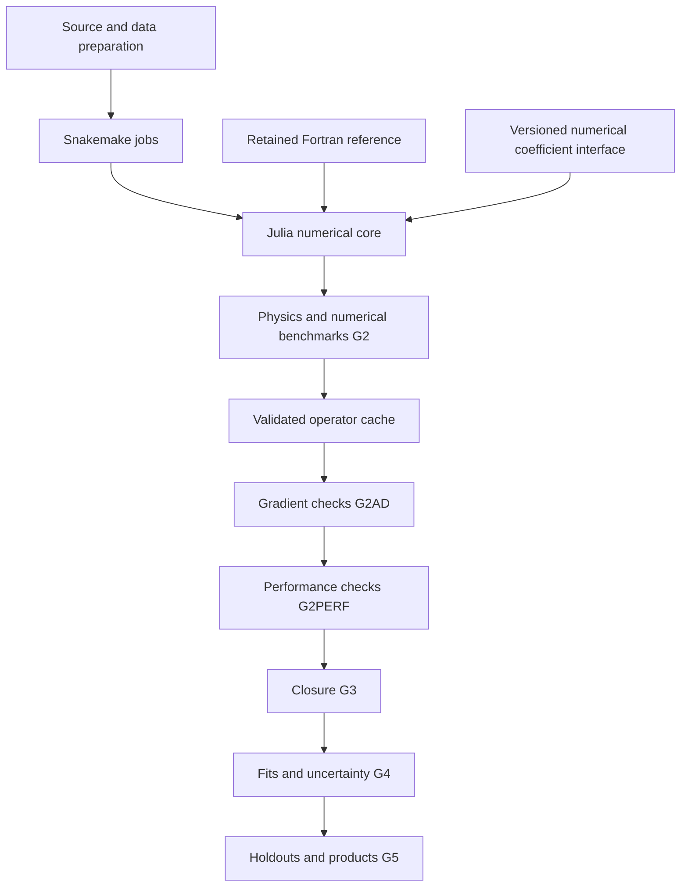

# Numerical architecture and validation

ADR-001 defines the project's Julia numerical core and Python/Snakemake orchestration. The synthetic runtime and fixed-operator batch ABI are implemented. Production theory and scientific admission remain incomplete; see [implementation status](implementation-status.md). Machine-readable requirements are in [numerical-backends.json](../config/numerical-backends.json), with dependencies in [workflow.json](../config/workflow.json).

## Job boundaries

Julia owns parameter transformations, operator application, process predictions, integration, likelihoods, derivatives, optimization and uncertainty calculations. Python handles source and data preparation, reporting and job coordination. Snakemake manages dependencies, resources, failures and restarts. Each Julia process executes a complete fit, replica collection, chain or validation job; numerical iterations do not call back into Python.

Independent reference jobs must use the same physics contract when testing numerical equivalence. Different theoretical approximations require separate benchmarks. Symbolic calculations connect through versioned numerical coefficient exports rather than the fitting loop.

## Fortran module policy

Pinned upstream sources in `external/` remain unchanged. Project-owned bridges or reviewed forks contain implementation changes, with the original backend retained for comparison.

| Action | Modules or interface | Requirements |
|---|---|---|
| Retain | HOPPET `evolution.f90`, `runge_kutta.f90` | Keep the evolution solver and stepper as reference implementations |
| Retain | `convolution.f90`, `interpolation.f90` | Preserve grid, endpoint and distribution handling |
| Retain | `qcd_coupling.f90`, `new_as.f90`, `special_functions.f90` | Preserve coupling, thresholds and special-function conventions |
| Optimize | `pdf_tabulate.F90`, `PreEvolvePdfTable`, `hoppetPreEvolve`, `hoppetCachedEvolve` | Reuse setup and buffers; batch operations and validate every cache dependency |
| Bridge | `streamlined_interface.f90` and project-owned `bind(C)` interfaces | Specify dimensions, ownership, errors and context isolation |
| Reconstruct | Missing paper-specific transversity and Collins evolution modifications | Implement the declared theory and validate independently; label reconstruction explicitly |
| Rewrite conditionally | Measured solver, convolution or interpolation hotspots | Profile first, preserve the API and pass physics, derivative, performance and closure checks |

The delivered batch ABI applies an existing Float64 operator. It does not build a production transversity evolution operator. The original KPSY15 fitting program and modified HOPPET implementation have not been located, and upstream polarized evolution is not a substitute.

The [retained HOPPET adapter](hoppet.md) now constructs a separately contracted reconstructed kernel. Query-bound rows are exported through the checked native adjoint and applied in generic Julia arithmetic after the native contexts close. This changes cache/application layout while retaining the upstream solver and convolution. Physical source-knot and derivative validation remain explicit; no production operator is admitted by a build or an analytic-component receipt.

The retained streamlined interface has module `SAVE` state. Use process isolation until shared-context concurrency is validated. Cap Julia, BLAS and OpenMP threads under Snakemake resources. Record compiler settings and precision; changes to floating-point reassociation or precision require separate validation.

## Evolution derivatives

For fixed coupling, initial scale, thresholds, order and grid settings, use

\[
h_1(Q;\theta)=U(Q,Q_0)h_1(Q_0;\theta),\qquad
\partial_\theta h_1=U\,\partial_\theta h_1(Q_0;\theta).
\]

Apply the operator in generic Julia arithmetic. The JVP is `U*delta_h0`; the real-valued VJP is `transpose(U)*cotangent_h`.

If fitted parameters affect the operator, include `(dU/dtheta)*h0` or use a validated differentiable solver. Parameter-dependent evolution, Sudakov factors and nonperturbative factors must not be silently frozen in a cache. The Collins evolution approximation is specified separately from transversity in the physics contract.

A Float64 foreign-function ABI does not automatically support automatic differentiation. Validate explicit derivative rules or keep the differentiated operator application in Julia. First-order rules do not establish Hessian support.

## Validation gates

Production acceptance settings require pilot calibration and a frozen policy hash. Failed checks cannot be bypassed by changing thresholds. Synthetic reports establish only their declared scope.

### Physics and numerical consistency: G2

- Match theory, data, parameters, scheme, perturbative order, scales, spin conventions, flavor ordering and units.
- Proposed per-bin asymmetry bounds are both an absolute difference of `1e-4` and `5%` of the experimental standard deviation. The proposed refinement budget is a total chi-square change below `0.1`. Analytic fixtures without experimental errors require explicit observable-specific budgets.
- Check endpoints, threshold neighborhoods, cancellations, mass and z factors, bin acceptance and angle conventions. Compare independent integration or evolution routes in matching domains. Tensor charges must follow their scale evolution rather than an incorrect conservation condition.
- Change each cache dependency and compare reuse with clean recomputation. Include fitted operator dependencies.
- Retain paired analyses with and without lattice constraints and process holdouts. Historical reproduction is qualified by the available source code and published precision.

### Derivative consistency: G2AD

- Use at least 12 parameter points and eight random directions per point, with fixed seeds and scaled coordinates. Include parameter-transform derivatives.
- The proposed comparison is `abs(d_AD-d_ref) <= 1e-6 + 1e-4*max(abs(d_AD),abs(d_ref))`.
- Scan central-difference steps from `1e-2` to `1e-6` and require a stable plateau. Unresolved finite differences do not pass.
- Check operator linearity, JVP/VJP and the adjoint dot-product identity. Initial adjoint bounds are `atol=1e-10`, `rtol=1e-8`; the proposed gradient-refinement relative budget is `1e-3`.
- Include nuisance profiling and covariance normalization derivatives when applicable. Validate Hessian-vector products and symmetry before using a Hessian for covariance estimates.
- Refine integration and evolution grids. Handle boundaries with valid interior points or smooth transformations rather than derivative-hiding clipping.

### Performance and resources: G2PERF

Measure matched workloads at the same accuracy, precision, hardware, seed and thread count. Separate startup, package loading, JIT compilation, initialization and I/O from warm execution. Collect at least 20 warm samples and report median, p95, allocations and peak memory.

Measure operator construction and cache application separately, together with objective-plus-gradient cost, fixed-budget optimization and replica throughput. Report end-to-end fitting time after G4. Posterior ESS per second applies only when posterior sampling is implemented and validated.

Use an accepted same-contract backend or uncached implementation as the baseline. Record unavailable comparisons as `N/A`. Separate language changes from algorithmic or precomputation improvements. The proposed warm-time regression budget is `10%`; freeze workload-specific time and memory budgets after the pilot. Synthetic timing does not establish a production speedup.

### Inference and products: G3-G5

Require noise-free recovery, noisy pseudoexperiment calibration and model-misspecification stress tests. Production interval coverage, multistart agreement, replica or posterior stability, endpoint sensitivity and holdouts require their own evidence. Compare sampled distributions within sampling uncertainty rather than requiring identical random trajectories.

Required reports include `benchmark-report.json`, `cache-validation-report.json`, `gradient-validation-report.json`, `performance-report.json`, `performance-budget.json` and `closure-report.json`. Record hashes, versions, seeds, compiler settings, precision, thread counts and the acceptance policy. Only valid receipts for the same scope and current inputs unlock downstream jobs.
